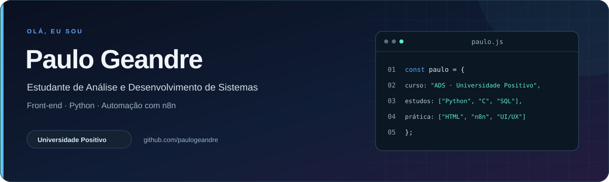

  

  
  

## Sobre mim

Sou **Paulo Geandre**, estudante de **Análise e Desenvolvimento de Sistemas na Universidade Positivo**, com interesse em desenvolvimento de software, inteligência artificial e automação.

Na graduação, estudo programação, automação, banco de dados e desenvolvimento de interfaces. Nos projetos acadêmicos e pessoais, aplico esses conhecimentos para entender problemas, organizar requisitos e construir soluções que possam ser testadas na prática.

- **Programação:** Python e linguagem C.
- **Automação:** criação de fluxos com n8n.
- **Banco de dados:** SQL.
- **Desenvolvimento web:** HTML e front-end para web.
- **Design de sistemas:** prototipagem, interfaces e jornada do usuário.

## Tecnologias e ferramentas

| Área | Tecnologias |
| :-- | :-- |
| **Programação** |   |
| **Automação e dados** |   |
| **Desenvolvimento web** |   |
| **Design e experiência** |   |
| **Versionamento** |   |

## Projetos em destaque

<table>
  <tr>
    <td width="50%" valign="top">
      
      <h3>PetVida · Clínica e Estética Animal</h3>
      
Protótipo acadêmico de gestão de atendimentos veterinários. Reúne agenda, cadastro de tutores e pets e histórico de atendimentos, com regras para evitar conflitos de horários.

      

        
        
        
      

      
<a href="https://paulogeandre.github.io/petvida-clinica/"><b>Ver demonstração</b></a> · <a href="https://github.com/paulogeandre/petvida-clinica">Ver código</a>

    </td>
    <td width="50%" valign="top">
      
      <h3>Meu primeiro portfólio</h3>
      
Site pessoal desenvolvido nas aulas de Desenvolvimento Web Básico. Apresenta minha formação, conhecimentos e projetos, colocando em prática a estruturação em HTML e a estilização com CSS.

      

        
        
      

      
<a href="https://github.com/paulogeandre/portfolio"><b>Explorar o projeto</b></a>

    </td>
  </tr>
</table>

## Formação e aprendizado

**Análise e Desenvolvimento de Sistemas — Universidade Positivo.**

Conteúdos estudados até o momento:

- Python.
- Automação com n8n.
- Linguagem C.
- SQL.
- Prototipagem de Sistemas Computacionais.
- Interface e Jornada do Usuário.
- Desenvolvimento Front-end para Web e HTML.

## Contato

**E-mail:** [paulogeandre@gmail.com](mailto:paulogeandre@gmail.com) 
**GitHub:** [@paulogeandre](https://github.com/paulogeandre)
